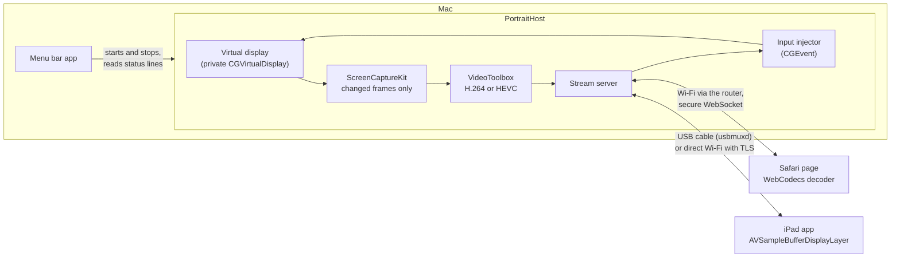

# PortraitDisplay

[](https://github.com/ggmax-gif/PortraitDisplay/actions/workflows/ci.yml)

Use an iPad as a portrait second screen for a Mac, without Sidecar. I wrote it because Sidecar on my
Mac only works in landscape, and I wanted a portrait page for reading documents.

The iPad can show it in Safari over Wi-Fi, with nothing to install. Or it can use the native iPad app,
which you build and install with Xcode. The app connects over the USB cable (round trips of about
6 ms), or over direct peer-to-peer Wi-Fi once paired (7 to 10 ms). It also adds Mac trackpad
gestures, and turning the iPad sideways makes the display landscape.

The Mac creates a portrait virtual monitor, captures it with ScreenCaptureKit and encodes it in
hardware as H.264 (or HEVC). The iPad decodes it in hardware as well, with WebCodecs in Safari and
AVSampleBufferDisplayLayer in the app. Touch and Apple Pencil input on the iPad is sent back and
replayed on the Mac.

Requirements: a Mac with Apple silicon on macOS 15 or later, with Xcode or the Command Line Tools.
For Safari, an iPad on iPadOS 16.4 or later, on the same network as the Mac, and a network that lets
devices talk to each other. For the app, iPadOS 17 or later, full Xcode and an Apple ID (a free one
works).

## Features

- A portrait display for your Mac at full Retina sharpness, sized to match the iPad (1024×1366 points
  on a 12.9-inch iPad Pro).
- Turn the iPad and the display turns with it: landscape at 90° and 270°, portrait upright or upside
  down (iPad app).
- USB-C cable with frame round trips of about 6 ms, or direct peer-to-peer Wi-Fi when unplugged, with
  no router in between (iPad app).
- Direct Wi-Fi is encrypted with a key the Mac gives the app over the cable. One iPad can pair with
  several Macs.
- Apple Pencil with pressure and tilt, finger taps, scrolling with momentum, and two-finger tap for
  right-click.
- Mac trackpad gestures: double tap, pinch to zoom, rotate, and three-finger swipes for Mission
  Control and Spaces (iPad app).
- Or no app at all: Safari on the same Wi-Fi, added to the Home Screen.
- A menu bar app with Start and Stop, a QR code for the iPad link and live stats. The display appears
  when the iPad connects and goes away after it leaves.
- Hardware H.264 or HEVC, and only changed frames are sent, so a still screen uses almost no network.
- MIT licensed, no third-party dependencies, and 42 unit tests that run on every push.

A 10-slide overview, with the measured latency and how it works:
[docs/PortraitDisplay-deck.pdf](docs/PortraitDisplay-deck.pdf).

## How it works



Frames go to the iPad; acknowledgements, decode times, touches and Pencil strokes come back. The
server sends a frame only when the iPad has acknowledged enough of the earlier ones, so a slow link
skips frames instead of building up lag.

## Install the menu bar app

```bash
git clone https://github.com/ggmax-gif/PortraitDisplay.git
cd PortraitDisplay
scripts/make-app.sh
open ~/Applications/"Portrait Display.app"
```

The script builds Portrait Display.app into `~/Applications`. Its menu bar icon has Start and Stop,
the link for the iPad (copy it, or show it as a QR code to scan), whether the iPad is connected, and
the latest stats while frames are flowing. The icon is dimmed while it's off.

The first time you press Start, macOS asks for Screen & System Audio Recording permission, and
Accessibility if you want touch input. If Start fails, the alert has a button to the right settings
page. The script signs the app with a self-signed certificate kept in `~/.portraitdisplay/signing`,
which is what lets those permissions survive rebuilds. If you delete that folder, macOS asks again.

As with Sidecar, the "Portrait iPad" display only exists while the iPad is connected. Start gets the
Mac ready, the display appears when the iPad connects, and it goes away 2 minutes after the iPad
leaves. Windows on it then move back to the main screen.

Settings in the menu holds the size (or matching the iPad app's screen size), Retina, frame rate, codec, bitrate cap, stream resolution,
touch input and port, how long the display stays after the iPad leaves (15 seconds to 15 minutes),
whether the display appears only while an iPad is connected, Start when the app opens, and Launch at
Login. Changes are saved as you make them; a number is saved when you press Return or leave the
field. While it's running, Restart Now applies them, which reconnects the iPad. Any other option from
the table below can go in an advanced default, which is added last and overrides the window:

```bash
defaults write com.danielfung.PortraitDisplay hostArguments -array --fps 90
```

Each run's output is in `~/Library/Logs/PortraitDisplay.log` (Show Log in the menu).

## Or use the iPad app

`iPad/` holds a native iPad app that shows the display over the USB-C cable. It needs no network or
certificate, and a round trip takes a few milliseconds rather than tens. The menu bar app finds it
whenever the iPad is plugged in and the app is open, and the menu then says "iPad connected (USB)".
Installing it needs Xcode and your Apple ID. After a one-time setup (`iPad/README.md`), `scripts/install-ipad.sh` builds the app and
installs it on the iPad. With a free Apple account an install lasts 7 days: the menu shows when it
runs out, and Reinstall iPad App runs the script again for another 7 days.

After the first USB connection, the app also works without the cable, over direct peer-to-peer Wi-Fi
(the link AirDrop uses), so it doesn't depend on the router or on the network letting devices reach
each other. The Mac gives the app a key over the cable, and Wi-Fi connections use TLS with that key,
so no other device can receive your screen and the stream is encrypted. Plugging the cable back in
switches to USB by itself. Typical round trips are 7 to 10 ms over direct Wi-Fi against about 6 ms
over USB, with occasional spikes to about 200 ms while the Mac's radio also serves the router.

Turn the iPad and the display turns with it: held sideways, the Mac's display becomes landscape
(1366×1024 on an iPad Pro 12.9"), and upright or upside down it's portrait. Windows on it stay there.
Safari always gets the portrait display.

The app can be paired with several Macs. Its Paired Macs button lists them and forgets one; Unpair
iPads… in the Mac's menu unpairs every iPad at once, until each is plugged in again.

## Or run it from Terminal

```bash
swift run -c release PortraitHost
```

The first build takes about a minute. The first time it runs, macOS asks to let Terminal record the
screen. Allow it, quit Terminal completely with ⌘Q, reopen it and run the command again. Terminal
then prints an address like `http://192.168.1.23:8080/?t=…`. Press Ctrl+C to stop; the virtual
monitor disappears with it.

## In Safari on the iPad

1. Join the same Wi-Fi as the Mac and turn Sidecar off.
2. Open the address in Safari.
3. The first time, the page asks you to install the Mac's certificate. Safari only runs the video
   decoder on secure (https) pages, and this certificate makes the iPad trust the Mac. Download it,
   install it in Settings → Profile Downloaded, then turn it on in Settings → General → About →
   Certificate Trust Settings. The page then opens the display by itself, at an `https://…:8081`
   address.
4. On that page, tap Share → Add to Home Screen, and open it from the Home Screen for a full-screen
   view. The link stays the same between runs, so you only do this once.
5. Tap with three fingers to show or hide the info overlay.

## Touch and Apple Pencil

| On the iPad | On the Mac |
|---|---|
| Pencil tap or drag | Click or drag, with pressure and tilt |
| Finger tap | Click (tap twice for a double-click) |
| Finger drag, one or two fingers | Scroll, with momentum |
| Two-finger tap | Right-click |
| Three-finger tap | Show or hide the overlay |

The native iPad app (`iPad/`) adds Mac trackpad gestures:

| On the iPad | On the Mac |
|---|---|
| Double or triple tap | Double-click or triple-click (taps close together are sent at the same spot) |
| Pinch | Zoom, in apps that pinch-zoom on a trackpad |
| Twist two fingers | Rotate |
| Three-finger swipe up or down | Mission Control or App Exposé |
| Three-finger swipe left or right | Switch Space or full-screen app |

Smart zoom (a two-finger double tap) isn't supported, and iPadOS keeps four- and five-finger gestures
for itself. The swipes press the Mac's Control-arrow shortcuts, so they follow whatever those are set
to in System Settings → Keyboard → Keyboard Shortcuts → Mission Control.

A mouse or trackpad connected to the iPad works like the Pencil. Input needs Accessibility
permission for the app (or for Terminal, if you run it from there) in System Settings → Privacy &
Security → Accessibility. Turn touch input off in Settings, or run with `--no-input`, to keep the iPad
view-only.

## On the Mac

The new monitor is called "Portrait iPad". Drag windows onto it like any other monitor, and put it
on the right side of your MacBook in System Settings → Displays → Arrange.

## Make it fit your iPad

The iPad app reports its screen size when it connects. With "Match the iPad app's screen size" on in
Settings (the default), the display restarts once at that size, for example 1024×1366 points on an
iPad Pro 12.9". It only does this while one iPad is connected.

In Safari, the default, 1024×1334 points, fits an iPad Pro 12.9" running the Home Screen app, whose
status bar takes 32 of the 1366 points. For any other iPad, or a Safari tab, the overlay shows the
size to use, for example `--width 820 --height 1180`. Enter those numbers in Settings, or pass them
on the command line:

```bash
swift run -c release PortraitHost --width 820 --height 1180
```

Other options (`--help` lists them all):

| Option | Default | What it does |
|---|---|---|
| `--scale 1.5` | 2 | Lower means less Wi-Fi traffic and slightly softer text |
| `--bitrate 10` | 20 | Video cap in Mbit/s while things move. Lower it for slow Wi-Fi |
| `--codec hevc` | h264 | About 40% less data while scrolling and half when the whole screen changes, but text is a little softer once the screen is still. An iPad that can't decode HEVC gets H.264 |
| `--fps 30` | 60 | Maximum updates per second. Lower it if the iPad can't keep up |
| `--port 9090` | 8080 | Uses this port and the next two (8080 to 8082). Change it if they're taken |
| `--no-hidpi` | off | Bigger UI, less sharp |
| `--no-input` | off | Ignore touch and Pencil (view only) |
| `--on-demand` | off | Show the display only while an iPad is connected (the menu bar app's default) |
| `--linger 120` | 15 | With `--on-demand`: seconds the display stays after the iPad leaves (the app uses 120) |

## Notes

- While an iPad is connected, the Mac's display doesn't idle off, because nothing can be captured
  while it's off. Closing the lid pauses the stream; it resumes on its own when you open it.
- Only frames that changed are sent, so a still screen uses almost no network. If the Wi-Fi can't
  keep up, frames are skipped rather than queued, and the stream resumes from a fresh keyframe, so it
  never falls behind.
- The certificate authority lives in `~/.portraitdisplay/`. It can only vouch for private network
  addresses (10.x, 172.16.x to 172.31.x, 192.168.x and 100.64.x to 100.127.x), never for real
  websites, and a new server certificate is issued for the Mac's current addresses on every run.
  Delete the folder, and the profile on the iPad, to start over.
- University and other managed networks (eduroam, for example) often block devices from reaching
  each other. On those, turn on your phone's hotspot and join both the Mac and the iPad to it. The
  stream stays between the devices, so it uses almost no mobile data.
- The page needs the `?t=…` key in the link, so other people on the network can't view your screen.
  The key is saved in `~/.portraitdisplay-token`; delete that file to get a new one.
- The virtual monitor uses a private macOS API, the same one BetterDisplay uses, so this can't go on
  the App Store.
- `docs/native-viewer-design.md` is the design of the native iPad app, with measured latency for USB,
  direct peer-to-peer Wi-Fi and the router; `Spike/link/` holds the test that measured them.

## Tests

`swift test` runs the unit tests: message framing, gesture decisions, the direct Wi-Fi TLS handshake
over loopback, the H.264 parameter-set patch (checked with a separate SPS parser), the HEVC codec
string, option parsing and the menu's settings. XCTest comes with full Xcode, so if the Command Line
Tools are selected, run `DEVELOPER_DIR=/Applications/Xcode.app/Contents/Developer swift test`.
GitHub Actions runs them on every push and also builds the iPad app, unsigned.

## License

MIT. See [LICENSE](LICENSE).
